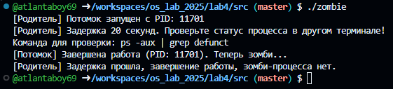
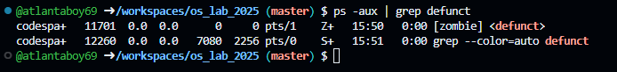
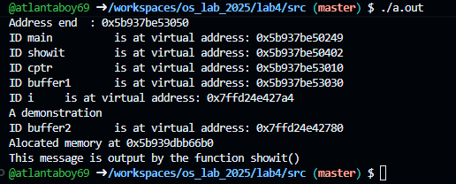
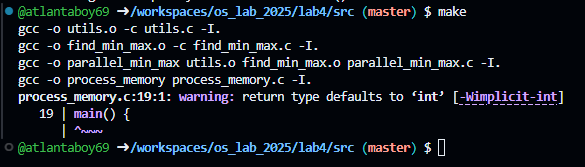
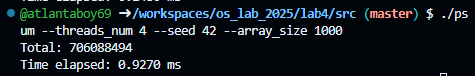

# Задание 1

1. Функция kill

• Суть: Отправляет сигнал процессу по его PID. SIGKILL (9) — принудительное завершение без возможности блокировки.
• В коде: Используется в alarm_handler внутри цикла для уничтожения зависших потомков: kill(child_pids[i], SIGKILL).

2. Таймер alarm, сигналы SIGALRM и signal

• Суть: alarm(N) запускает таймер на N секунд, по истечении которого ядро шлет сигнал SIGALRM. Вызов signal() связывает этот сигнал с пользовательским обработчиком.
• В коде: Регистрация и запуск: signal(SIGALRM, alarm_handler); alarm(timeout);. Сброс таймера при успешном завершении: alarm(0).

3. Неблокирующий wait с WNOHANG

• Суть: Обычный wait() замораживает родительский процесс. Флаг WNOHANG в функции waitpid() делает опрос неблокирующим: если никто не завершился, она мгновенно возвращает 0, не останавливая программу.
• В коде: Реализуется через замену wait(&status) на waitpid(-1, &status, WNOHANG) внутри цикла проверки дочерних процессов.

# Задание 2

1. Теория: Что такое зомби-процессы?

• Что это: Зомби-процесс (defunct) — это процесс, который уже завершил свое выполнение (вызвал exit), но все еще имеет запись в таблице процессов ОС. Он находится в «терминальном состоянии».
• Как появляются: Когда дочерний процесс завершается, ядро ОС освобождает его память и ресурсы. Однако запись о нем (включая PID и статус выхода) сохраняется в таблице процессов, чтобы родительский процесс мог прочитать этот статус с помощью системного вызова wait() или waitpid(). До тех пор, пока родитель не прочитает этот статус, потомок остается зомби.
• Как исчезают: Зомби полностью удаляется (вычищается) из таблицы процессов сразу после того, как родитель вызывает функцию группы wait() - или как в нашем случае заканчивается код main.
• Чем опасны: Сами по себе зомби не потребляют процессорное время и оперативную память для кода (они мертвы). Но они занимают слоты в таблице процессов (идентификаторы PID). Если зомби станет слишком много, в системе закончатся свободные PID, и ОС не сможет запускать новые процессы. Также они могут удерживать открытыми невычищенные буферы дескрипторов.

# Задание 3

Объяснение назначения переменных etext, edata, end

Эти переменные не создаются программистом. Их автоматически генерирует компилятор (линкер) в процессе сборки исполняемого файла программы. Они хранят адреса-границы, разделяющие память процесса на логические сегменты:

1. etext (End of Text)

• За что отвечает: Указывает на конец сегмента кода (Text Segment).
• Связь с выводом: Всё, что находится до адреса etext — это исполняемые машинные инструкции. В эту область попадают адреса функций main (0x5b937be50249) и showit (0x5b937be50402). Данный сегмент защищен операционной системой от записи (доступен только для чтения и выполнения).

2. edata (End of Data)

• За что отвечает: Указывает на конец сегмента инициализированных данных (Data Segment).
• Связь с выводом: В области между etext и edata лежат глобальные и статические переменные, которым в коде изначально присвоено значение. В вашем выводе граница edata равна 0x5b937be53018. Глобальный указатель cptr имеет адрес 0x5b937be53010, что четко меньше этой границы, подтверждая его нахождение в сегменте данных.

3. end (End of BSS)

• За что отвечает: Указывает на конец сегмента неинициализированных данных (BSS Segment) и одновременно на начало Кучи (Heap).
• Связь с выводом: В промежутке между edata (...3018) и end (0x5b937be53050) располагаются глобальные переменные без начального значения (при старте ОС автоматически зануляет их). Ваш массив buffer1 имеет адрес 0x5b937be53030, что идеально вписывается в рамки BSS-сегмента.
• Сразу за адресом end начинается динамическая память (Куча), откуда malloc выделил адрес для buffer2 — 0x5b939dbb66b0 (адрес заметно больше end, так как куча растет вверх).

# Задание 4

# Задание 5

Теоретические вопросы задания

• Как создавать POSIX threads:
С помощью системного вызова pthread_create:

int pthread_create(pthread_t *thread, const pthread_attr_t *attr, void *(*start_routine) (void *), void *arg);

Функция принимает указатель на идентификатор потока, атрибуты (NULL по умолчанию), функцию-точку входа и указатель на передаваемые аргументы.
• Как дожидаться завершения:
С помощью блокирующего вызова pthread_join:

int pthread_join(pthread_t thread, void **retval);

Функция ожидает завершения указанного потока и опционально считывает возвращённое им значение через retval.
• Как линковаться на библиотеку pthread:
При компиляции через gcc необходимо передать флаг -pthread (или -lpthread):bash
gcc -o psum parallel_sum.c -L. -lsum -pthread

