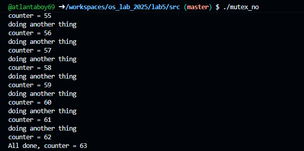
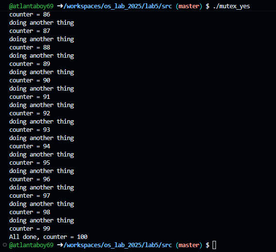
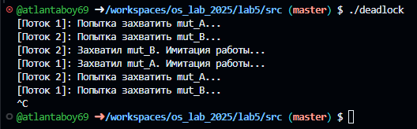

# Задание 1

1. $(CC) -o parallel_min_max utils.o find_min_max.o parallel_min_max.c
2. Состояние гонки - когда один или несколько потоков обращаются к одним и тем же данным для изменения или чтения, без синхронизации они будут работать с разными версиями файлов во времени
3. Критическая секция - Когда несколько потоков одновременно пытаются читать и изменять одни и те же данные, возникает состояние гонки (race condition), из-за чего программа может работать непредсказуемо или аварийно завершаться. Критическая секция гарантирует, что в один момент времени этот участок кода выполняет только один поток. Мьютекс решает ту же проблему, но мьютекс работает аппаратно на уровне ядра, а не на уровне пользователя.
4. комментарии в коде
5. -pthread не только подключает саму библиотеку libpthread, но и активирует в компиляторе системные макросы потокобезопасные версии стандартных функций C.

## Объяснение
мы намеренно растягиваем операцию первую в пустом цикле, чтобы ос переключила планировщик задач на второй поток, он считывает старое значение с первого потока и в результате они оба работают с разым значением переменной
1. Вызовы pthread_mutex_lock(&mut) и pthread_mutex_unlock(&mut) образуют критическую секцию.
2. Когда поток 1 захватывает мьютекс, поток 2 при попытке войти в свою секцию принудительно засыпает (блокируется операционной системой).
3. Поток 1 гарантированно завершает всю цепочку действий (чтение  инкремент  долгий цикл  запись в память) и только потом отпускает мьютекс.
4. Поток 2 просыпается и читает уже обновленное, корректное значение.

# Задание 2 по коду

# Задание 3
два потока ожидают освобождения ресурсов, занятых друг другом, один поток хочет взять mut_b и не может отдать mut_a, а у другого противоположная ситуация

