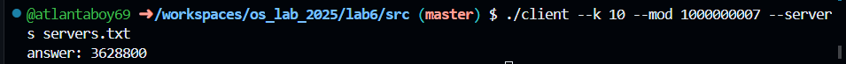
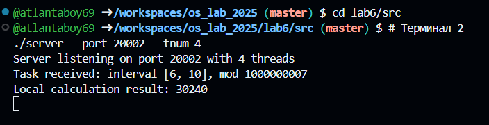
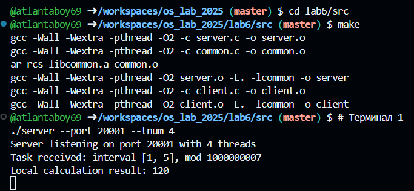

### 1. TCP и TCP/IP

**Стек TCP/IP** — это 4-уровневая архитектура сетевого взаимодействия:

* **Прикладной уровень (Application):** протокол вычисления факториала (передача 24 байт задачи и 8 байт ответа).
* **Транспортный уровень (Transport):** протокол TCP (`SOCK_STREAM`) — организует двусторонний надежный логический канал связи между процессами с адресацией по портам.
* **Сетевой уровень (Internet):** протокол IP (`AF_INET`) — маршрутизирует пакеты между сетевыми узлами по IP-адресам.
* **Канальный уровень (Link):** кадры Ethernet/Wi-Fi на уровне сетевой карты.

**TCP (Transmission Control Protocol)** — протокол с установлением соединения (Three-way handshake: `SYN` $\to$ `SYN-ACK` $\to$ `ACK`), контролем целостности (контрольные суммы), гарантией доставки (квитирование `ACK`, повторная отправка при тайм-ауте) и сохранением строгого порядка байтов (`Sequence Number`).

```c
// Использование стека IPv4 (AF_INET) и протокола TCP (SOCK_STREAM)
int sck = socket(AF_INET, SOCK_STREAM, 0);

// Приведение адреса и порта к сетевому порядку байт (Big-Endian)
struct sockaddr_in server_addr;
server_addr.sin_family = AF_INET;
server_addr.sin_port = htons((uint16_t)port);      // Host TO Network Short (16 бит)
server_addr.sin_addr.s_addr = htonl(INADDR_ANY);   // Host TO Network Long (32 бита)

```

---

### 2. TCP vs UDP

| Параметр | TCP (`SOCK_STREAM`) | UDP (`SOCK_DGRAM`) |
| --- | --- | --- |
| **Соединение** | Требуется установка логической сессии | Не требуется (датаграммы отправляются сразу) |
| **Надежность** | Гарантированная (подтверждения `ACK`, повтор) | Не гарантируется (возможна потеря пакетов) |
| **Порядок данных** | Строго сохраняется | Не гарантируется (пакеты могут перемешаться) |
| **Границы сообщений** | Нет (непрерывный байтовый поток) | Есть (каждый вызов отправляет отдельный пакет) |

**Обоснование выбора TCP:**

Вычисление факториала $k! \pmod{mod}$ требует абсолютной математической точности. Если при использовании UDP потеряется хотя бы один пакет с диапазоном или промежуточным ответом одного из серверов, итоговый результат будет испорчен. TCP гарантирует целостность и факт доставки данных.

```c
// server.c: создание потокового TCP-сокета с гарантией доставки
int server_fd = socket(AF_INET, SOCK_STREAM, 0);

```

---

### 3. Системный вызов `socket`

```c
int socket(int domain, int type, int protocol);

```

**Механизм работы в ядре ОС:**

1. Выделяет в памяти ядра структуры сокета (`struct socket` и `struct sock`).
2. Создает два системных кольцевых буфера: буфер отправки (**Send Buffer**) и буфер приема (**Receive Buffer**).
3. Создает запись в таблице открытых файлов текущего процесса и возвращает наименьший свободный целочисленный файловый дескриптор.

**Аргументы:**

* `domain = AF_INET`: семейство сетевых адресов IPv4.
* `type = SOCK_STREAM`: надежный двусторонний байтовый поток (TCP).
* `protocol = 0`: автоматический выбор протокола ядра по умолчанию для пары `AF_INET` + `SOCK_STREAM` (`IPPROTO_TCP`).

```c
// client.c: создание клиентского сокета в рабочем потоке
int sck = socket(AF_INET, SOCK_STREAM, 0);
if (sck < 0) {
    perror("Socket creation failed");
    return NULL;
}

```

---

### 4. Системный вызов `bind`

```c
int bind(int sockfd, const struct sockaddr *addr, socklen_t addrlen);

```

**Механизм работы в ядре ОС:**

Связывает дескриптор сокета с локальным сетевым адресом (IP-адрес сетевого интерфейса и номер TCP-порта). При получении входящих пакетов сетевой стек ОС перенаправляет их процессу, владеющему сокетом с данным портом.

* **`INADDR_ANY` (`0.0.0.0`):** предписывает ядру принимать пакеты, адресованные на любые физические и виртуальные сетевые интерфейсы машины (локальная петля `127.0.0.1`, локальная сеть, внешний IP).
* **Опция `SO_REUSEADDR`:** после закрытия сервера порт остается заблокированным ядром в состоянии `TIME_WAIT` (до 120 секунд) для отлова блуждающих пакетов. Флаг `SO_REUSEADDR` разрешает повторный `bind` на этот порт сразу после перезапуска.
* **Почему клиенту не нужен `bind`:** клиенту не принципиален локальный порт отправки — при вызове `connect()` ядро ОС автоматически выделяет свободный эфемерный порт (ephemeral port, диапазон 32768–60999).

```c
// server.c: разрешение повторного использования порта и привязка сокета
int opt_val = 1;
setsockopt(server_fd, SOL_SOCKET, SO_REUSEADDR, &opt_val, sizeof(opt_val));

struct sockaddr_in server_addr;
memset(&server_addr, 0, sizeof(server_addr));
server_addr.sin_family = AF_INET;
server_addr.sin_port = htons((uint16_t)port);
server_addr.sin_addr.s_addr = htonl(INADDR_ANY);

if (bind(server_fd, (struct sockaddr *)&server_addr, sizeof(server_addr)) < 0) {
    perror("Can not bind to socket");
    close(server_fd);
    return 1;
}

```

---

### 5. Системный вызов `listen`

```c
int listen(int sockfd, int backlog);

```

**Механизм работы в ядре ОС:**

Переводит сокет из активного состояния в пассивное (слушающее). В сетевом стеке ядра инициализируются две очереди:

1. **SYN Queue:** полуустановленные соединения (получен `SYN`, отправлен `SYN-ACK`, ожидается финальный `ACK`).
2. **Accept Queue:** полностью установленные соединения (3-way handshake завершен), готовые к обработке программой.

* **Параметр `backlog = 128`:** задает максимальное количество полностью установленных соединений в очереди **Accept Queue**, ожидающих вызова `accept()`. При переполнении очереди новые запросы сбрасываются.

```c
// server.c: переход в режим ожидания входящих подключений
if (listen(server_fd, 128) < 0) {
    perror("Could not listen on socket");
    close(server_fd);
    return 1;
}

```

---

### 6. Системный вызов `accept`

```c
int accept(int sockfd, struct sockaddr *addr, socklen_t *addrlen);

```

**Механизм работы в ядре ОС:**

Извлекает первое завершенное соединение из очереди **Accept Queue**. Если очередь пуста, вызов блокирует поток до появления входящего клиента. Создает и возвращает **новый сокет** (`client_fd`).

**Разделение дескрипторов:**

* `server_fd` (слушающий): привязан к локальному порту, используется только для приема новых запросов.
* `client_fd` (выделенный рабочий сокет): привязан к конкретной сессии (четверка: *IP клиента, порт клиента, IP сервера, порт сервера*), через него ведется прием и передача данных конкретного сеанса.

```c
// server.c: извлечение клиентского соединения
struct sockaddr_in client_addr;
socklen_t client_len = sizeof(client_addr);

int client_fd = accept(server_fd, (struct sockaddr *)&client_addr, &client_len);
if (client_fd < 0) {
    perror("Could not establish new connection");
    continue;
}

```

---

### 7. Системный вызов `recv`

```c
ssize_t recv(int sockfd, void *buf, size_t len, int flags);

```

**Механизм работы в ядре ОС:**

Копирует поступившие по сети байты из приемного буфера ядра (**Socket Receive Buffer**) в буфер процесса `buf`.

* Возвращает `> 0`: количество фактически прочитанных байт.
* Возвращает `0`: соединение закрыто удаленной стороной (получен пакет с флагом `FIN`).
* Возвращает `< 0`: ошибка чтения (код ошибки сохраняется в `errno`).

**Зачем нужен цикл накопления байт:**

TCP — потоковый протокол без сохранения границ сообщений. Из-за фрагментации сети на уровне MTU пакет размером 24 байта может быть доставлен частями (например, 14 и 10 байт). Одиночный вызов `recv` может прочитать только часть структуры, поэтому чтение выполняется в цикле до полного заполнения буфера.

```c
// server.c: гарантированное считывание ровно 24 байт (begin, end, mod)
unsigned int buffer_size = sizeof(uint64_t) * 3;
char from_client[buffer_size];
ssize_t bytes_read = 0;

while ((size_t)bytes_read < buffer_size) {
    ssize_t r = recv(client_fd, from_client + bytes_read, buffer_size - bytes_read, 0);
    if (r <= 0) {
        bytes_read = r; // r == 0: EOF от клиента; r < 0: сетевая ошибка
        break;
    }
    bytes_read += r;
}

```

---

### 8. Системный вызов `send`

```c
ssize_t send(int sockfd, const void *buf, size_t len, int flags);

```

**Механизм работы в ядре ОС:**

Копирует данные из буфера приложения `buf` в системный буфер отправки ядра (**Socket Send Buffer**). Сегментацию, расчет контрольных сумм и фактическую отправку сетевых пакетов ядро ОС берет на себя.

**Ключевая особенность:**

Успешный возврат из `send()` **не означает**, что удаленный хост получил данные. Это лишь подтверждение того, что ОС приняла данные в свой внутренний буфер отправки.

```c
// client.c: сериализация и отправка диапазона вычислений серверу
char payload[sizeof(uint64_t) * 3];
memcpy(payload, &task->begin, sizeof(uint64_t));
memcpy(payload + sizeof(uint64_t), &task->end, sizeof(uint64_t));
memcpy(payload + 2 * sizeof(uint64_t), &task->mod, sizeof(uint64_t));

if (send(sck, payload, sizeof(payload), 0) < 0) {
    perror("Send failed");
    close(sck);
    return NULL;
}

```

---

### 9. Системный вызов `close`

```c
int close(int fd);

```

**Механизм работы в ядре ОС:**

Декрементирует системный счетчик ссылок на структуру сокета. Когда счетчик достигает нуля:

1. Инициирует стандартную 4-этапную процедуру разрыва TCP-соединения (**Four-way teardown handshake**), отправляя удаленной стороне сегмент с флагом `FIN`.
2. Очищает буферы приема и отправки сокета.
3. Освобождает целочисленный дескриптор `fd` в таблице процесса для повторного использования.

* **Разница с `shutdown()`:** `shutdown(fd, SHUT_RDWR)` немедленно закрывает канал передачи данных и шлет `FIN`, но сохраняет сам дескриптор открытым до тех пор, пока процесс явно не вызовет `close(fd)`.

```c
// server.c: закрытие сессии с текущим клиентом
shutdown(client_fd, SHUT_RDWR); // Завершение сессии TCP
close(client_fd);               // Освобождение дескриптора сокета

// client.c: закрытие сетевого дескриптора в завершающемся потоке
close(sck);

```

---

### 10. Системный вызов `connect`

```c
int connect(int sockfd, const struct sockaddr *addr, socklen_t addrlen);

```

**Механизм работы в ядре ОС:**

Инициирует трехстороннее рукопожатие (**Three-way Handshake**) с удаленным узлом:

1. Если сокет не был привязан через `bind`, ядро выделяет сокету эфемерный локальный порт.
2. Отправляет на целевой IP и порт TCP-пакет `SYN`.
3. Блокирует вызвавший поток до получения ответа `SYN-ACK` и отправки подтверждения `ACK`.
4. Если сервер не слушает порт, возвращает ошибку `-1` (`errno = ECONNREFUSED`).

```c
// client.c: подключение к удаленному серверу из отдельного потока
struct sockaddr_in server_addr;
memset(&server_addr, 0, sizeof(server_addr));
server_addr.sin_family = AF_INET;
server_addr.sin_port = htons((uint16_t)task->server.port);
memcpy(&server_addr.sin_addr.s_addr, hostname->h_addr_list[0], hostname->h_length);

if (connect(sck, (struct sockaddr *)&server_addr, sizeof(server_addr)) < 0) {
    fprintf(stderr, "Connection to %s:%d failed\n", task->server.ip, task->server.port);
    close(sck);
    return NULL;
}

```