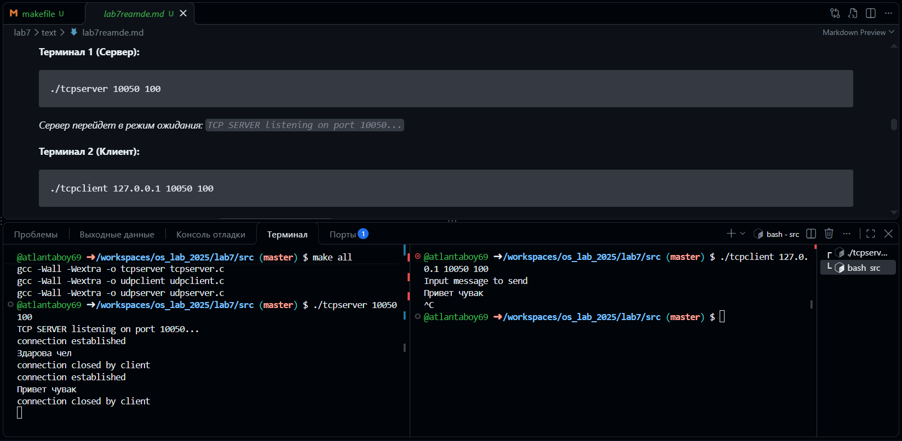
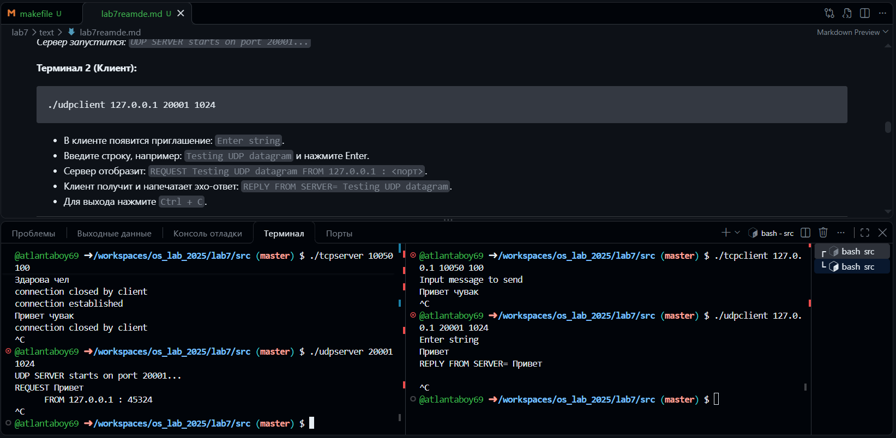

# Отчет по лабораторной работе №7: Сетевое программирование сокетов (TCP и UDP)

---

## Содержание
1. [Цель работы и постановка задачи](#1-цель-работы-и-постановка-задачи)
2. [Необходимые теоретические знания (с примерами из кода)](#2-необходимые-теоретические-знания-с-примерами-из-кода)
   - [2.1. Компиляция программ на языке C и утилита make](#21-компиляция-программ-на-языке-c-и-утилита-make)
   - [2.2. Аргументы командной строки в C](#22-аргументы-командной-строки-в-c)
   - [2.3. Протокол TCP и потоковые сокеты](#23-протокол-tcp-и-потоковые-сокеты)
   - [2.4. Протокол UDP и датаграммные сокеты](#24-протокол-udp-и-датаграммные-сокеты)
   - [2.5. Сравнительный анализ TCP и UDP](#25-сравнительный-анализ-tcp-и-udp)
3. [Руководство по сборке и запуску (План действий)](#3-руководство-по-сборке-и-запуску-план-действий)
4. [Задание 2: Ответы на контрольные вопросы](#4-задание-2-ответы-на-контрольные-вопросы)
   - [Вопрос 1: Что делают оба приложения?](#вопрос-1-что-делают-оба-приложения)
   - [Вопрос 2: Что произойдет, если tcpclient отправит сообщение незапущенному серверу?](#вопрос-2-что-произойдет-если-tcpclient-отправит-сообщение-незапущенному-серверу)
   - [Вопрос 3: Что произойдет, если udpclient отправит сообщение незапущенному серверу?](#вопрос-3-что-произойдет-если-udpclient-отправит-сообщение-незапущенному-серверу)
   - [Вопрос 4: Что произойдет, если tcpclient отвалится во время работы с сервером?](#вопрос-4-что-произойдет-если-tcpclient-отвалится-во-время-работы-с-сервером)
   - [Вопрос 5: Что произойдет, если udpclient отвалится во время работы с сервером?](#вопрос-5-что-произойдет-если-udpclient-отвалится-во-время-работы-с-сервером)
   - [Вопрос 6: Что произойдет, если udpclient отправит сообщение на несуществующий / выключенный сервер?](#вопрос-6-что-произойдет-если-udpclient-отправит-сообщение-на-несуществующий--выключенный-сервер)
   - [Вопрос 7: Что произойдет, если tcpclient отправит сообщение на несуществующий / выключенный сервер?](#вопрос-7-что-произойдет-если-tcpclient-отправит-сообщение-на-несуществующий--выключенный-сервер)
   - [Вопрос 8: В чем отличия UDP и TCP протоколов?](#вопрос-8-в-чем-отличия-udp-и-tcp-протоколов)

---

## 1. Цель работы и постановка задачи

**Цель:** Изучение низкоуровневого сетевого взаимодействия в операционных системах семейства UNIX/Linux через интерфейс сокетов Беркли (Berkeley Sockets API), исследование работы протоколов транспортного уровня TCP и UDP, их различий, жизненного цикла соединений и поведения в нештатных ситуациях.

**Задачи:**
1. Модифицировать исходные коды четырех программ (`tcpclient.c`, `tcpserver.c`, `udpclient.c`, `udpserver.c`), вынеся все жестко заданные константы (порт сервера, размер буфера) из директив `#define` в аргументы командной строки (`argv`).
2. Разработать файл автоматизации сборки `Makefile` для раздельной и совместной компиляции всех программ с флагами предупреждений.
3. Провести тестирование сетевых приложений в штатном режиме и при возникновении ошибок (незапущенный сервер, обрыв клиента, несуществующий узел).
4. Подготовить развернутые ответы на контрольные вопросы с подтверждающими скриншотами.

---

## 2. Необходимые теоретические знания (с примерами из кода)

### 2.1. Компиляция программ на языке C и утилита make

Сборка программы на языке C из исходного кода в исполняемый бинарный файл состоит из 4 последовательных этапов:
1. **Препроцессирование (`gcc -E`):** обработка директив препроцессора (`#include`, `#define`, `#ifdef`), подстановка заголовочных файлов и макросов, удаление комментариев.
2. **Компиляция (`gcc -S`):** трансляция препроцессированного исходного кода на языке C в ассемблерный код целевой архитектуры процессора (x86-64).
3. **Ассемблирование (`gcc -c`):** перевод ассемблерных инструкций в машинный код и формирование объектных файлов (`.o`).
4. **Компоновка / Линковка (`gcc -o`):** объединение одного или нескольких объектных файлов со статическими и динамическими библиотеками (например, `libc`), разрешение внешних ссылок и формирование исполняемого файла ELF.

Для автоматизации сборки используется утилита `make` и файл сценария `Makefile`. Он описывает дерево зависимостей и команды для их сборки:

```makefile
CC = gcc
CFLAGS = -Wall -Wextra

all: tcpclient tcpserver udpclient udpserver

tcpclient: src/tcpclient.c
	$(CC) $(CFLAGS) -o tcpclient src/tcpclient.c

tcpserver: src/tcpserver.c
	$(CC) $(CFLAGS) -o tcpserver src/tcpserver.c

udpclient: src/udpclient.c
	$(CC) $(CFLAGS) -o udpclient src/udpclient.c

udpserver: src/udpserver.c
	$(CC) $(CFLAGS) -o udpserver src/udpserver.c

clean:
	rm -f tcpclient tcpserver udpclient udpserver

.PHONY: all clean tcp udp
```
- Флаги `-Wall -Wextra` включают расширенную диагностику потенциальных ошибок и предупреждений компилятора.
- `.PHONY` указывает цели, которые не создают одноименных файлов на диске.

---

### 2.2. Аргументы командной строки в C

Входная точка программы на C имеет следующую сигнатуру:
```c
int main(int argc, char *argv[])
```
- `argc` (*argument count*) — целое число, количество переданных параметров (включая имя самой программы `argv[0]`).
- `argv` (*argument vector*) — массив указателей на нуль-терминированные строки (`char*`).

Изначально в исходном коде параметры портов и буферов были зашиты макросами `#define`:
```c
// Было (статические константы препроцессора):
#define SERV_PORT 10050
#define BUFSIZE 100
char buf[BUFSIZE];
```

В соответствии с заданием, данные константы вынесены в аргументы командной строки, а память под буфер выделяется динамически с помощью `malloc()`:
```c
// Стало (динамическое чтение из командной строки):
int main(int argc, char *argv[]) {
  if (argc < 3) {
    fprintf(stderr, "Usage: %s <port> <bufsize>\n", argv[0]);
    exit(1);
  }

  int port = atoi(argv[1]);
  int bufsize = atoi(argv[2]);

  if (port <= 0 || bufsize <= 0) {
    fprintf(stderr, "Invalid port or bufsize\n");
    exit(1);
  }

  char *buf = malloc(bufsize);
  if (!buf) {
    perror("malloc");
    exit(1);
  }
  // ... работа с сокетом ...
  free(buf);
  return 0;
}
```

---

### 2.3. Протокол TCP и потоковые сокеты

**TCP (Transmission Control Protocol)** — протокол транспортного уровня, обеспечивающий надежную передачу данных с предварительным установлением логического соединения (connection-oriented) в виде непрерывного байтового потока (Byte Stream).

#### Ключевые механизмы TCP:
1. **Установление соединения (Three-Way Handshake):**
   - Клиент отправляет сегмент с флагом `SYN` и начальным номером последовательности `ISN_c`.
   - Сервер отвечает сегментом с флагами `SYN` + `ACK` (подтверждает получение и отправляет свой `ISN_s`).
   - Клиент отправляет сегмент `ACK`. Соединение установлено (`ESTABLISHED`).
2. **Гарантия доставки и целостности:**
   - Каждому переданному байту присваивается порядковый номер (Sequence Number).
   - Получатель отправляет подтверждение (`ACK`) для принятых данных. Если отправитель не получает `ACK` до истечения таймаута (RTO), происходит повторная передача (retransmission).
   - Контрольная сумма (Checksum) в заголовке гарантирует целостность данных.
3. **Управление потоком и перегрузкой (Flow & Congestion Control):**
   - Окно приема (Receive Window) предотвращает переполнение буфера получателя.
   - Алгоритмы Slow Start, Congestion Avoidance, Fast Retransmit / Fast Recovery адаптируют скорость отправки под пропускную способность сети.
4. **Завершение соединения (Four-Way Handshake):**
   - Сторона, инициирующая закрытие, отправляет сегмент с флагом `FIN`.
   - Вторая сторона подтверждает `ACK` и впоследствии отправляет свой `FIN`.
   - Первая сторона подтверждает получение `ACK`, переводя сокет в состояние `TIME_WAIT`.

#### Жизненный цикл вызовов API сокетов TCP:

| Сервер (`tcpserver.c`) | Клиент (`tcpclient.c`) |
| :--- | :--- |
| `socket(AF_INET, SOCK_STREAM, 0)` — создание сокета | `socket(AF_INET, SOCK_STREAM, 0)` — создание сокета |
| `bind(lfd, &servaddr, sizeof)` — привязка к IP/порту | Заполнение структуры `servaddr` адресом сервера |
| `listen(lfd, 5)` — перевод сокета в режим прослушивания | |
| `accept(lfd, &cliaddr, &len)` — блокировка до подключения клиента | `connect(fd, &servaddr, sizeof)` — 3-way handshake |
| `read(cfd, buf, bufsize)` — чтение потока байт | `write(fd, buf, nread)` — передача данных в сокет |
| `close(cfd)` — закрытие клиентского сокета | `close(fd)` — отправка FIN, закрытие сокета |

#### Пример из кода `src/tcpserver.c`:
```c
// 1. Создание потокового сокета (TCP)
lfd = socket(AF_INET, SOCK_STREAM, 0);

// 2. Настройка адреса: прослушивать все сетевые интерфейсы (INADDR_ANY)
servaddr.sin_family = AF_INET;
servaddr.sin_addr.s_addr = htonl(INADDR_ANY);
servaddr.sin_port = htons(port); // сетевой порядок байт (Big-Endian)

// 3. Привязка сокета к адресу и порту
bind(lfd, (struct sockaddr *)&servaddr, kSize);

// 4. Очередь ожидания подключений до 5 клиентов
listen(lfd, 5);

// 5. Извлечение первого запроса на подключение из очереди
cfd = accept(lfd, (struct sockaddr *)&cliaddr, &clilen);
```

---

### 2.4. Протокол UDP и датаграммные сокеты

**UDP (User Datagram Protocol)** — минималистичный протокол транспортного уровня без установления соединения (connectionless). Передает данные в виде независимых пакетов — датаграмм (Datagrams).

#### Ключевые механизмы UDP:
1. **Отсутствие соединения:** перед отправкой данных не происходит согласования (handshake). Отправитель просто передает датаграмму в сеть с указанием целевого IP и порта.
2. **Отсутствие гарантий доставки и порядка:** пакеты могут быть потеряны, продублированы или прийти в произвольном порядке. UDP не отправляет подтверждений (`ACK`) и не производит повторных отправок.
3. **Сохранение границ сообщений:** в отличие от потокового TCP, каждый вызов `sendto()` формирует отдельную датаграмму, которая принимается за один вызов `recvfrom()`.
4. **Минимальный заголовок:** размер заголовка UDP составляет всего 8 байт (против 20–60 байт у TCP), что обеспечивает минимальные сетевые накладные расходы и задержки.

#### Жизненный цикл вызовов API сокетов UDP:

| Сервер (`udpserver.c`) | Клиент (`udpclient.c`) |
| :--- | :--- |
| `socket(AF_INET, SOCK_DGRAM, 0)` | `socket(AF_INET, SOCK_DGRAM, 0)` |
| `bind(sockfd, &servaddr, sizeof)` — фиксация порта сервера | Заполнение `servaddr` (порт и IP сервера) |
| `recvfrom(sockfd, mesg, bufsize, 0, &cliaddr, &len)` — прием датаграммы и адреса клиента | `sendto(sockfd, sendline, n, 0, &servaddr, len)` — отправка датаграммы |
| `sendto(sockfd, mesg, n, 0, &cliaddr, len)` — ответ клиенту | `recvfrom(sockfd, recvline, bufsize, 0, NULL, NULL)` — ожидание ответа |
| `close(sockfd)` | `close(sockfd)` |

#### Пример из кода `src/udpserver.c`:
```c
// Создание датаграммного сокета UDP
sockfd = socket(AF_INET, SOCK_DGRAM, 0);

// Прием датаграммы с сохранением адреса отправителя в cliaddr
n = recvfrom(sockfd, mesg, bufsize, 0, (struct sockaddr *)&cliaddr, &len);

// Отправка эхо-ответа обратно отправителю
sendto(sockfd, mesg, n, 0, (struct sockaddr *)&cliaddr, len);
```

---

### 2.5. Сравнительный анализ TCP и UDP

| Характеристика | TCP (Transmission Control Protocol) | UDP (User Datagram Protocol) |
| :--- | :--- | :--- |
| **Тип соединения** | Ориентирован на соединение (Connection-oriented, 3-way handshake) | Без установления соединения (Connectionless) |
| **Гарантия доставки** | Гарантированная (подтверждения ACK, таймеры retransmission) | Не гарантируется (Best-effort delivery) |
| **Порядок доставки** | Строго упорядочен (номера последовательности Sequence Numbers) | Порядок не гарантируется |
| **Формат данных** | Непрерывный байтовый поток (Byte Stream, границы не сохраняются) | Дискретные датаграммы (Datagrams, границы сохраняются) |
| **Контроль перегрузки/потока** | Есть (Sliding Window, Congestion Window, Slow Start) | Отсутствует |
| **Размер заголовка** | 20 – 60 байт | Фиксированный, 8 байт |
| **Системные вызовы** | `socket`, `bind`, `listen`, `accept`, `connect`, `read`, `write` | `socket`, `bind`, `recvfrom`, `sendto` |
| **Применение** | Web (HTTP/HTTPS), передача файлов (FTP, SFTP), SSH, Email (SMTP) | DNS, видео/аудио трансляции (VoIP, WebRTC), сетевые игры, NTP |

---

## 3. Руководство по сборке и запуску (План действий)

### Шаг 1. Компиляция программ через make
В терминале перейдите в корневую директорию лабораторной работы и выполните:
```bash
make clean
make
```
В результате компилятор соберет четыре исполняемых файла:
- `tcpserver`
- `tcpclient`
- `udpserver`
- `udpclient`

---

### Шаг 2. Запуск и тестирование TCP приложения
Для работы требуются два открытых терминала (или вкладки).

**Терминал 1 (Сервер):**
```bash
./tcpserver 10050 100
```
*Сервер перейдет в режим ожидания: `TCP SERVER listening on port 10050...`*

**Терминал 2 (Клиент):**
```bash
./tcpclient 127.0.0.1 10050 100
```
- В клиенте появится приглашение: `Input message to send`.
- Введите текст, например: `Hello TCP Server!` и нажмите Enter.
- В Терминале 1 сервер выведет полученное сообщение.
- Для завершения сеанса клиента нажмите `Ctrl + D` (EOF) или `Ctrl + C`.

---

### Шаг 3. Запуск и тестирование UDP приложения

**Терминал 1 (Сервер):**
```bash
./udpserver 20001 1024
```
*Сервер запустится: `UDP SERVER starts on port 20001...`*

**Терминал 2 (Клиент):**
```bash
./udpclient 127.0.0.1 20001 1024
```
- В клиенте появится приглашение: `Enter string`.
- Введите строку, например: `Testing UDP datagram` и нажмите Enter.
- Сервер отобразит: `REQUEST Testing UDP datagram FROM 127.0.0.1 : <порт>`.
- Клиент получит и напечатает эхо-ответ: `REPLY FROM SERVER= Testing UDP datagram`.
- Для выхода нажмите `Ctrl + C`.

---

## 4. Задание 2: Ответы на контрольные вопросы

### Вопрос 1: Что делают оба приложения?

**Ответ:**

1. **TCP-приложение (`tcpserver` и `tcpclient`):**
   - Реализует клиент-серверную передачу данных через надежный байтовый поток.
   - **`tcpserver`** создает сокет `SOCK_STREAM`, привязывается к заданному порту (`bind`), переходит в режим прослушивания (`listen`) и ожидает входящих подключений (`accept`). Получив подключение, сервер в цикле вычитывает байты из клиентского дескриптора сокета вызовом `read()` и выводит их в терминал (`write(1, ...)`). После закрытия соединения со стороны клиента сервер закрывает текущий сокет `cfd` и снова ожидает нового клиента в вызове `accept()`.
   - **`tcpclient`** подключается к серверу по IP-адресу и порту через `connect()`. После успешного установления TCP-соединения клиент считывает пользовательский ввод со стандартного потока ввода (`read(0, ...)`) и отправляет его серверу через системный вызов `write(fd, ...)`.

2. **UDP-приложение (`udpserver` и `udpclient`):**
   - Реализует эхо-сервис на базе протокола дейтаграмм без сохранения сессии.
   - **`udpserver`** открывает сокет `SOCK_DGRAM`, привязывается к порту (`bind`) и переходит в ожидание датаграмм через `recvfrom()`. При получении датаграммы сервер выводит на экран текст запроса, а также IP-адрес и порт клиента (извлеченные из `cliaddr`), после чего отправляет полученное сообщение обратно клиенту вызовом `sendto()`.
   - **`udpclient`** запрашивает у пользователя ввод строки, упаковывает ее в датаграмму и отправляет серверу вызовом `sendto()`. Затем клиент блокируется в вызове `recvfrom()`, ожидая ответную датаграмму от сервера, и при получении выводит ее на консоль: `REPLY FROM SERVER= ...`.

#### Как воспроизвести для скриншота:
1. Запустите в левом терминале `./tcpserver 10050 100`, в правом `./tcpclient 127.0.0.1 10050 100`. Отправьте строку.
2. Запустите в левом терминале `./udpserver 20001 1024`, в правом `./udpclient 127.0.0.1 20001 1024`. Отправьте строку.




---

### Вопрос 2: Что произойдет, если tcpclient отправит сообщение незапущенному серверу?

**Ответ:**

Клиент **не отправит сообщение**, так как выполнение программы прервется еще на этапе установления соединения.
- При вызове `connect()` клиент отправляет на указанный IP-адрес и порт TCP-пакет с флагом `SYN` для инициализации Three-Way Handshake.
- Поскольку процесс сервера не запущен и порт никто не слушает, операционная система хоста-получателя не обнаруживает сокета в состоянии `LISTEN` на данном порту и отправляет обратно пакет с флагом `RST` (Reset, сброс соединения).
- Получив `RST`, ядро ОС клиента немедленно завершает вызов `connect()` с ошибкой `-1`, выставляя код ошибки `errno = ECONNREFUSED` (*Connection refused — В соединении отказано*).
- В коде `tcpclient.c`:
  ```c
  if (connect(fd, (SADDR *)&servaddr, SIZE) < 0) {
    perror("connect");
    exit(1);
  }
  ```
  Срабатывает обработчик `perror("connect")`, программа выводит сообщение `connect: Connection refused` и завершает работу с кодом `1`. До цикла чтения ввода и отправки сообщения `write()` программа даже не доходит.

#### Как воспроизвести для скриншота:
Убедитесь, что сервер не запущен, и выполните:
```bash
./tcpclient 127.0.0.1 9999 100
```
*Вывод:*
```
connect: Connection refused
```

<!-- Скриншот выполнения вопроса 2 -->
```markdown

```

---

### Вопрос 3: Что произойдет, если udpclient отправит сообщение незапущенному серверу?

**Ответ:**

- В протоколе UDP предварительное соединение не устанавливается. Поэтому системный вызов `sendto()` в клиенте **успешно отрабатывает**: ядро формирует UDP-пакет, передает его в сетевой стек и возвращает количество отправленных байт. Со стороны клиента отправка выглядит успешно выполненной.
- Затем клиент переходит к следующей инструкции — вызову `recvfrom()`:
  ```c
  if ((n = recvfrom(sockfd, recvline, bufsize, 0, NULL, NULL)) == -1) {
    perror("recvfrom problem");
    exit(1);
  }
  ```
- Так как сервер не запущен, никто не сгенерирует и не пришлет ответную датаграмму.
- Сокет клиента работает в стандартном блокирующем режиме без установленного таймаута (`SO_RCVTIMEO`).
- **Итог:** клиент «намертво зависает» в вызове `recvfrom()`, бесконечно ожидая ответа от несуществующего/незапущенного сервера, пока пользователь принудительно не прервет процесс нажатием `Ctrl + C`.
*(Примечание: операционная система может локально сгенерировать служебный ICMP-пакет «Port Unreachable», однако для стандартного непривязанного через `connect()` UDP-сокета он не прерывает блокирующий `recvfrom()`)*.

#### Как воспроизвести для скриншота:
Убедитесь, что `udpserver` не запущен, и выполните:
```bash
./udpclient 127.0.0.1 29999 1024
```
Введите любую строку и нажмите Enter. Программа отправит строку и зависнет в ожидании ответа.

<!-- Скриншот выполнения вопроса 3 -->
```markdown

```

---

### Вопрос 4: Что произойдет, если tcpclient отвалится во время работы с сервером?

**Ответ:**

- Если клиент аварийно завершается (например, нажат `Ctrl + C`, процесс убит сигналом `kill -9` или упал с ошибкой `SIGSEGV`), операционная система клиента автоматически закрывает все дескрипторы файлов и сокетов, принадлежавшие этому процессу.
- В рамках сетевого стека TCP ядро отправляет серверу сегмент с флагом `FIN` (штатное завершение соединения) либо `RST` (сброс соединения).
- **На стороне сервера (`tcpserver`):**
  Сервер в этот момент находится в цикле чтения данных из сокета:
  ```c
  while ((nread = read(cfd, buf, bufsize)) > 0) {
    write(1, buf, nread);
  }
  ```
  - При получении пакета `FIN` системный вызов `read()` возвращает значение `0`, что в семантике сокетов UNIX означает признак конца файла (**EOF** — End of File / удаленная сторона закрыла соединение).
  - Цикл `while` завершается естественным образом.
  - Сервер выполняет `close(cfd)`, освобождая дескриптор клиентского соединения, и переходит на следующую итерацию внешнего цикла `while(1)`.
  - Вновь вызывается блокирующий вызов `accept(lfd, ...)`.
  - **Сервер не падает!** Он корректно обрабатывает отключение клиента и продолжает работать, ожидая подключения следующих клиентов.

#### Как воспроизвести для скриншота:
1. В Терминале 1 запустите: `./tcpserver 10050 100`
2. В Терминале 2 запустите: `./tcpclient 127.0.0.1 10050 100`
3. Отправьте тестовую строку (убедитесь, что соединение установлено).
4. В Терминале 2 нажмите `Ctrl + C` (клиент отвалился).
5. Посмотрите в Терминал 1: сервер зафиксировал закрытие соединения (`connection closed by client`) и остался ждать новые подключения.

<!-- Скриншот выполнения вопроса 4 -->
```markdown

```

---

### Вопрос 5: Что произойдет, если udpclient отвалится во время работы с сервером?

**Ответ:**

- Протокол UDP не сохраняет состояния (stateless) и не поддерживает постоянного логического соединения между узлами.
- Сервер не хранит таблиц подключенных клиентов: он просто выполняет `recvfrom()` в бесконечном цикле, обрабатывая каждую приходящую датаграмму изолированно.
- При завершении или падении процесса `udpclient` операционная система клиента **не отправляет никаких управляющих пакетов в сеть** (в UDP нет аналогов пакетов `FIN` или `RST`).
- **Сервер абсолютно никак не узнает, что клиент завершился.** Для сервера ничего не произошло — он продолжает находиться в состоянии ожидания очередной датаграммы от любого клиента в вызове `recvfrom()`. Никаких ошибок не возникает.

#### Как воспроизвести для скриншота:
1. В Терминале 1 запустите: `./udpserver 20001 1024`
2. В Терминале 2 запустите: `./udpclient 127.0.0.1 20001 1024`
3. Отправьте строку `ping` и получите ответ.
4. Закройте клиент в Терминале 2 по `Ctrl + C`. Сервер в Терминале 1 не реагирует и продолжает штатную работу.

<!-- Скриншот выполнения вопроса 5 -->
```markdown

```

---

### Вопрос 6: Что произойдет, если udpclient отправит сообщение на несуществующий / выключенный сервер?

**Ответ:**

- Вызов `sendto()` в коде клиента завершается **успешно**: датаграмма формируется, помещается в исходящий буфер сетевого адаптера и отправляется в сеть.
- Поскольку сервер выключен или не существует в сети:
  1. Если IP-адрес вообще отсутствует в локальной сети: маршрутизатор или локальный стек безуспешно отправляют ARP-запросы на получение MAC-адреса узла. По истечении тайм-аута пакет отбрасывается.
  2. Если пакет доходит до маршрутизатора, у которого нет маршрута к указанной сети, маршрутизатор может вернуть ICMP-сообщение «Destination Host Unreachable» / «Network Unreachable».
- Однако клиентский сокет UDP является неподключенным (`unconnected socket`), поэтому он не привязан к конкретному адресу и игнорирует асинхронные входящие ошибки ICMP в вызове `recvfrom()`.
- Клиент переходит к вызову `recvfrom()` и **бесконечно блокируется**, ожидая ответа, который никогда не придет.

#### Как воспроизвести для скриншота:
Отправьте сообщение на заведомо несуществующий в локальной подсети IP-адрес (например, `172.29.192.200` или немаршрутизируемый тестовый адрес `192.0.2.1`):
```bash
./udpclient 192.0.2.1 20001 1024
```
Введите строку. Программа отправит ее и останется висеть в вызове `recvfrom()`.

<!-- Скриншот выполнения вопроса 6 -->
```markdown

```

---

### Вопрос 7: Что произойдет, если tcpclient отправит сообщение на несуществующий / выключенный сервер?

**Ответ:**

Клиент **не сможет отправить сообщение**, так как не сможет установить TCP-соединение на этапе вызова `connect()`.
- Функция `connect()` отправляет сетевой пакет `SYN` на указанный IP-адрес для начала рукопожатия и запускает внутренний таймер ожидания ответа.
- Так как удаленный сервер выключен или хост не существует:
  1. Ответных пакетов `SYN+ACK` или `RST` не поступает.
  2. Сетевой стек ядра TCP начинает процедуру повторной отправки (TCP SYN Retransmissions) с экспоненциальным увеличением интервалов.
  3. По истечении системного лимита времени на установление соединения (таймаут TCP, обычно от 30 секунд до 2 минут) ядро прерывает попытки подключения.
  4. Вызов `connect()` возвращает `-1`, а переменная `errno` устанавливается в `ETIMEDOUT` (*Connection timed out — Время ожидания соединения истекло*).
  5. Если шлюз/маршрутизатор сразу определяет отсутствие маршрута или узла, он может вернуть пакет `ICMP Host Unreachable`, и тогда `connect()` завершится быстрее с ошибкой `EHOSTUNREACH` (*No route to host*).
- В любом случае функция `connect()` завершается аварийно, срабатывает `perror("connect")`, и программа закрывается до этапа отправки сообщения.

#### Как воспроизвести для скриншота:
Попробуйте подключиться к несуществующему хосту в подсети (например, `172.29.192.200`):
```bash
./tcpclient 172.29.192.200 10050 100
```
Программа будет ожидать ответа в течение таймаута, после чего завершится с ошибкой соединения.

<!-- Скриншот выполнения вопроса 7 -->
```markdown

```

---

### Вопрос 8: В чем отличия UDP и TCP протоколов?

**Ответ:**

Протоколы TCP и UDP располагаются на транспортном уровне модели OSI и стека TCP/IP, однако спроектированы для принципиально разных задач.

| Критерий | TCP (Transmission Control Protocol) | UDP (User Datagram Protocol) |
| :--- | :--- | :--- |
| **Установление соединения** | Обязательно. Требуется предварительное трехстороннее рукопожатие (SYN, SYN-ACK, ACK). | Не требуется (Connectionless). Данные отправляются сразу. |
| **Гарантия доставки** | Гарантирует доставку каждого байта. Использует механизм подтверждений (ACK) и повторной отправки (Retransmission). | Не гарантирует (Best-effort). Пакеты могут теряться без уведомления отправителя. |
| **Порядок доставки** | Строго гарантируется. Пакеты упорядочиваются по номерам Sequence Number; дубликаты отбрасываются. | Не гарантируется. Датаграммы могут прийти в произвольном порядке или дублироваться. |
| **Формат передачи данных** | Потоковый (Byte Stream). Данные передаются непрерывным потоком байт, границы отдельных сообщений стираются. | Датаграммный (Message-oriented). Каждое сообщение передается отдельным пакетом с сохранением границ. |
| **Контроль перегрузки и потока** | Полноценный контроль: алгоритмы управления окном (Sliding Window), адаптация к перегрузке канала (Slow Start, AIMD). | Отсутствует. Отправитель шлет данные с любой скоростью независимо от состояния сети. |
| **Размер заголовка** | 20 байт (минимальный) до 60 байт (с опциями). | Фиксированный и компактный — 8 байт. |
| **Скорость и задержка** | Выше накладные расходы, возможны задержки из-за ожидания подтверждений (Head-of-Line Blocking). | Максимальная скорость передачи с минимальными сетевыми задержками. |
| **Системные вызовы ОС** | `socket(..., SOCK_STREAM, ...)`, `listen`, `accept`, `connect`, `read`, `write` | `socket(..., SOCK_DGRAM, ...)`, `recvfrom`, `sendto` |
| **Сфера применения** | Сервисы, где критична 100% точность: HTTP/HTTPS (веб), SSH, FTP (файлы), SMTP/IMAP (почта), базы данных. | Сервисы, где критична скорость и минимальная задержка, а потери допустимы: DNS, VoIP, онлайн-игры, видеостриминг. |

<!-- Скриншот выполнения вопроса 8 -->
```markdown

```

---

## 5. Заключение

В ходе выполнения лабораторной работы:
1. Были модифицированы все четыре программы: жестко закодированные константы (`SERV_PORT`, `BUFSIZE`) вынесены в аргументы командной строки с динамическим выделением памяти.
2. Создан `Makefile`, позволяющий компилировать все компоненты одной командой `make`.
3. На практике исследованы механизмы функционирования протоколов TCP и UDP, получены навыки работы с потоковыми и датаграммными сокетами в Linux.
4. Рассмотрены различные внештатные ситуации и зафиксированы различия в реакциях сетевого стека для протоколов с установлением соединения (TCP) и без установления соединения (UDP).
